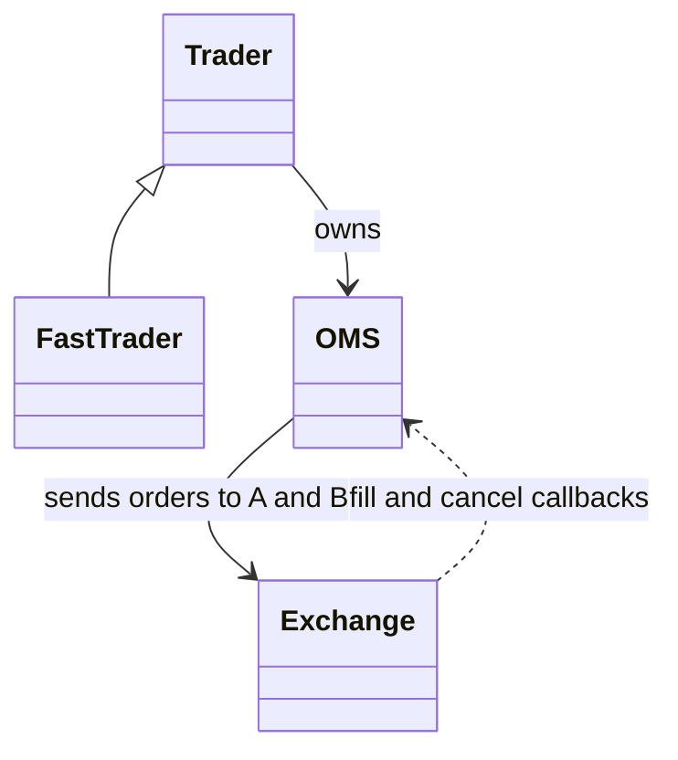

# Multi-Exchange Order Matching Engine and Trading Simulation (C++)

An object-oriented stock-market simulator: two identical exchanges, a price-time-priority matching engine, an order management system, five randomised **slow traders** and one cross-exchange arbitrage **fast trader**, run through a simulated 6.5-hour trading day.

Built in C++17 for the JPMorgan Chase QMP programming assignment.

| | |
|---|---|
| **Language** | C++17 (plus a small Python script for plotting) |
| **Securities** | AAPL, GOOGL, MSFT, AMZN, META |
| **Simulated day** | 23,400 s (6.5 hours) in 0.5 s steps |
| **Run time** | About one second per full trading day |
| **Report** | [`report/report.tex`](report/report.tex) |

---

## Highlights

- **Matching engine with strict price-time priority.** Each price level is a FIFO queue, so earlier orders at the same price always fill first.
- **Two independent exchanges** quoting the same five securities, so prices can diverge and arbitrage becomes possible.
- **Top-5 depth rule.** After every order, price levels beyond the best five on each side are cancelled automatically.
- **Event-driven order management system (OMS).** Exchanges call back into each trader's OMS on every fill and cancellation, which keeps cash and holdings in sync.
- **Two trader behaviours on different clocks.** Slow traders act on whole seconds, the fast trader on half-second ticks.
- **Per-tick profit tracking** exported to CSV and plotted with one command.

---

## Architecture



| Component | File | Responsibility |
|---|---|---|
| `Exchange` | `src/Exchange.*` | Order book per symbol, matching, top-5 pruning, trading hours, end-of-day cleanup, market data queries |
| `OMS` | `src/OMS.*` | Cash and holdings per trader, order routing to either exchange, portfolio valuation |
| `Trader` | `src/Trader.*` | The slow trader: random buy/sell decisions, pricing, feasibility checks, bank-to-trading-account transfers |
| `FastTrader` | `src/FastTrader.*` | Subclass of `Trader` that replaces random trading with cross-exchange arbitrage |
| `ProfitTracker` | `src/ProfitTracker.*` | Records P&L for every trader at every tick and writes `profits.csv` |
| `Common.h` | `src/Common.h` | Shared types: `Order`, `Trade`, `Quote`, `OrderCancellation` |
| `main.cpp` | `src/main.cpp` | Builds the world and runs the simulation loop |

---

## How the exchange works

**Order book.** Bids are stored in a `std::map` sorted highest price first, asks lowest price first. Each price level holds a `std::list` of orders in arrival order, which gives time priority without any extra sorting. Total quantity per price level is cached so quote reads never have to walk a list.

**Matching.** After each new order the engine repeatedly compares the best bid with the best ask. While the best bid is at or above the best ask, it fills the front orders of both levels for the smaller of the two quantities. A trade executes at the price of the earlier-arrived order (the resting order), and at the ask price if the timestamps tie.

**Cancellations.** The exchange tells the owning OMS why an order was cancelled:

| Reason | When |
|---|---|
| `OUTSIDE_TOP_5` | The order's price level fell outside the best five levels on its side |
| `OUTSIDE_TRADING_HOURS` | The order arrived outside market hours |
| `END_OF_DAY` | All resting orders are cleared at market close |

**Market data.** The exchange exposes last traded price, best bid and offer, and the top five levels of depth for each side.

---

## The traders

| | Slow trader (`Trader`) | Fast trader (`FastTrader`) |
|---|---|---|
| **Acts at** | Whole seconds (t = 0, 1, 2, ...) | Half-second points (t = 0.5, 1.5, 2.5, ...) |
| **Strategy** | Random | Cross-exchange arbitrage |
| **Count / IDs** | 5 traders, IDs 0 to 4 | 1 trader, ID 5 |
| **Bank balance** | 100,000,000 each | 5,000,000 |
| **Order size** | 1,000 shares (or the remaining holding, if a sell is smaller) | Up to 1,000 shares, limited by the quantity quoted on both sides |

### Slow trader

On each whole second, for each of the five symbols, the trader:

1. Chooses buy or sell with equal probability.
2. Picks a price at random from the best bid, the best ask, and the midpoint of the two (whichever exist), taking the best quotes across both exchanges. If neither exchange has any bid or ask it quotes 5 % above or below the last traded price, with a fallback of 10.
3. Checks the order is affordable (buy) or covered by holdings (sell), topping up the trading account from the bank if a buy needs more cash.
4. Sends the order to whichever exchange does not already have an order at that price on the same side, or to a random exchange if both or neither do.

### Fast trader

On each half-second tick, for each symbol, it compares the two exchanges:

- If the best **bid on A** is above the best **ask on B**, it buys on B and sells on A at the same instant.
- Otherwise, if the best **bid on B** is above the best **ask on A**, it buys on A and sells on B.

It only trades if it already holds enough cash for the buy leg and enough shares for the sell leg, so it never shorts or borrows.

---

## Simulation setup

| Parameter | Value |
|---|---|
| Time step | 0.5 s |
| Trading day | 23,400 s (market open 0, close 23,400) |
| Exchanges | 2 identical (`EXCH_A`, `EXCH_B`) |
| Starting portfolio | Random 10,000 to 50,000 shares of each symbol (in lots of 1,000) per trader, plus half of the bank balance moved into the trading account |
| P&L definition | Current bank + trading cash + holdings valued at the average last traded price across both exchanges (10 if nothing has traded), minus starting wealth |
| Randomness | Seeded from `std::random_device`, so every run is different |

---

## Getting started

**Requirements:** a C++17 compiler (developed and checked with g++ 13). Plotting also needs Python 3 with `pandas` and `matplotlib`.

```bash
# 1. Build
g++ -std=c++17 -O2 -o simulation src/*.cpp

# 2. Run a full trading day (writes profits.csv in the current directory)
./simulation

# 3. Plot P&L over time (writes graphs/profit_graph.png)
pip install pandas matplotlib
python3 scripts/plot_results.py
```

Run the commands from the repository root. On a machine with no display, run the plot step with `MPLBACKEND=Agg` to skip the pop-up window.

`profits.csv` has one row per time step and one column per trader (`0` to `4` for the slow traders, `5` for the fast trader).

---

## Results

A sample run is saved in [`results/`](results/). The project report ([`report/report.tex`](report/report.tex)) shows four more independent runs under [`report/graphs/`](report/graphs/).


End-of-day P&L for the same run ([`results/profits.csv`](results/profits.csv)):

| Trader | Type | End-of-day P&L |
|---|---|---|
| 0 | Slow | ≈ 37.5 M |
| 1 | Slow | ≈ 38.5 M |
| 2 | Slow | ≈ 36.8 M |
| 3 | Slow | ≈ 35.0 M |
| 4 | Slow | ≈ 34.6 M |
| 5 | Fast | ≈ −13 k |

**What the runs show**

- **The matching engine and order book behave as designed:** price-time priority holds and the top-5 pruning keeps books compact.
- **Slow-trader profits are not trading skill.** Each slow trader starts with a free stock allocation. As trading moves prices up from the starting fallback level, the marked-to-market value of those holdings rises, and that shows up as profit. Their decisions are random.
- **The fast trader earns very little.** Because slow traders spread orders across both exchanges, the two books stay close together and leave few arbitrage windows. Its end-of-day P&L stays small (here about −13 k, against tens of millions for slow traders), and it varies from run to run.

---

## Limitations and extensions

- The fast trader cannot short-sell or borrow, which limits how often it can trade.
- Order size is fixed at 1,000 shares, and prices fall back to 10 when no trade has happened yet.
- There are no transaction costs. The report notes that adding them would make the random slow traders unprofitable.
- The simulation is single-threaded and not seeded, so runs are not reproducible.

Natural next steps: add transaction costs, allow the fast trader to short, run several competing fast traders, and add a fixed seed option for repeatable experiments.

---

## Repository structure

```
.
├── README.md
├── src/                 # C++ source: exchange, OMS, traders, simulation loop
├── scripts/
│   └── plot_results.py  # plots profits.csv
├── results/             # sample simulation output (CSV and plot)
└── report/
    ├── report.tex       # project report (LaTeX)
    └── graphs/          # figures used in the report
```

---


